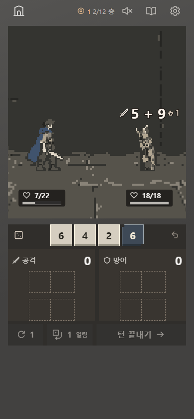

# D62 해금 공격 보정 제거

**강적 우선 경로의 완주율은 48.27%로 목표 상한 45%를 3.27%p 초과했습니다.** 이 지점에서 밸런스 작업을 멈췄습니다. 변경은 `unlock-no-penalty` 브랜치에서 규칙판 5 기믹 교체 묶음에 합칠 수 있습니다.

구현 커밋은 `b8bdefb8e4e67ce342d3fda821530ea62c0eeaca`입니다.

## 적용과 저장 호환

- 새로 하기는 규칙판 5로 시작합니다. 두 해금 모두 정예와 보스를 포함한 모든 적의 공격에 0을 더합니다. 규칙판 4의 지도 생성, 적 체력과 공격 패턴, 약초 붕대 회복량을 계승합니다.
- 저장은 시작할 때의 규칙판으로 지도를 복원합니다. 지도 규칙판 1~4와 초기 3전투 저장은 해당 규칙으로 이어집니다. 이전 버전에서 생성한 10층 철갑 기사 저장을 불러온 뒤 공격 예고 `6 + 7`, 적 체력 34, 선택한 주사위를 확인했습니다. 12층 보스에서도 이전 규칙의 공격 예고 `11 + 10`과 체력 84로 이어져 완주했습니다.
- `npm test` 144개와 `npm run build`가 통과했습니다. 규칙판 4와 5에서 4,096개 시드의 지도 구조 일치도 확인했습니다.

## 사람형 봇 완주율

기존 사람형 정책 `guardFirst`와 기존 가중 시작 특전 선택을 사용했습니다. 경로와 규칙판 조합마다 같은 시드 8,192~12,287로 4,096판을 돌렸습니다. 보수 경로는 이벤트·상인·일반 전투를 우선하고, 강적 우선 경로는 갈림길에서 강적을 먼저 고릅니다.

| 경로 | 적용 전 · 규칙판 4 | 적용 후 · 규칙판 5 | 변화 | 목표 30~45% |
| --- | ---: | ---: | ---: | --- |
| 보수 | 1,413/4,096 (34.50%) | 1,481/4,096 (36.16%) | +1.66%p | 범위 내 |
| 강적 우선 | 1,289/4,096 (31.47%) | 1,977/4,096 (48.27%) | +16.80%p | 상한 초과 |

### 층별 이탈

각 수치는 해당 층 진입판 중 그 층을 완료하기 전에 패배한 판의 비율입니다.

| 층 | 보수 전 | 보수 후 | 강적 우선 전 | 강적 우선 후 |
| --- | ---: | ---: | ---: | ---: |
| 1층 | 237/4,096 (5.79%) | 237/4,096 (5.79%) | 237/4,096 (5.79%) | 237/4,096 (5.79%) |
| 2층 | 233/3,859 (6.04%) | 233/3,859 (6.04%) | 200/3,859 (5.18%) | 175/3,859 (4.53%) |
| 3층 | 177/3,626 (4.88%) | 177/3,626 (4.88%) | 342/3,659 (9.35%) | 246/3,684 (6.68%) |
| 4층 | 225/3,449 (6.52%) | 225/3,449 (6.52%) | 367/3,317 (11.06%) | 251/3,438 (7.30%) |
| 5층 | 225/3,224 (6.98%) | 225/3,224 (6.98%) | 381/2,950 (12.92%) | 261/3,187 (8.19%) |
| 6층 | 305/2,999 (10.17%) | 305/2,999 (10.17%) | 407/2,569 (15.84%) | 307/2,926 (10.49%) |
| 7층 | 164/2,694 (6.09%) | 164/2,694 (6.09%) | 296/2,162 (13.69%) | 217/2,619 (8.29%) |
| 8층 | 125/2,530 (4.94%) | 125/2,530 (4.94%) | 176/1,866 (9.43%) | 123/2,402 (5.12%) |
| **9층** | 746/2,405 (31.02%) | 746/2,405 (31.02%) | 198/1,690 (11.72%) | 174/2,279 (7.63%) |
| 10층 | 134/1,659 (8.08%) | 134/1,659 (8.08%) | 94/1,492 (6.30%) | 66/2,105 (3.14%) |
| 11층 | 0/1,525 (0.00%) | 0/1,525 (0.00%) | 0/1,398 (0.00%) | 0/2,039 (0.00%) |
| **12층 보스** | 112/1,525 (7.34%) | 44/1,525 (2.89%) | 109/1,398 (7.80%) | 62/2,039 (3.04%) |

보수 경로의 9층 봉인 파수꾼에서 진입 758판 중 655판(86.41%)이 이탈했습니다. 규칙판 4와 5에서 동일했습니다. 강적 우선의 9층 강적 전투만 집계하면 198/1,047판(18.91%)에서 174/1,411판(12.33%)으로 이탈률이 낮아졌습니다.

### 재현 명령

저장소 루트에서 PowerShell로 실행합니다. 출력 배열은 층별 `[진입, 완료]`입니다.

```powershell
@'
import { playRulesThree, weightedPerks } from './exp/map/stage-three.mjs'
const pickPerk = weightedPerks()
for (const rules of [4, 5]) {
  for (const preferElite of [false, true]) {
    const floors = Array.from({ length: 12 }, () => [0, 0])
    for (let seed = 8192; seed < 12288; seed++) {
      const run = playRulesThree(seed, pickPerk(seed), 'guardFirst', preferElite, undefined, rules)
      for (let index = 0; index < run.path.length; index++) {
        floors[index][0]++
        if (index < run.completed) floors[index][1]++
      }
    }
    console.log(JSON.stringify({ rules, preferElite, floors }))
  }
}
'@ | node.exe --input-type=module -
```

## 모바일 화면

헤드리스 크롬에서 빌드 결과를 390×844로 열고, 시드 0의 새 등반을 로비에서 두 번 시작했습니다. 첫 판은 해금 0개, 두 번째 판은 1층에서 에고 주사위와 추가 재굴림을 모두 해금한 상태로 같은 2층 정예전에 진입했습니다. 두 판에서 첫 턴 공격 예고는 **`5 + 9`**였고, 두 해금을 보유한 저장을 다시 불러온 뒤에도 같은 수치가 표시됐습니다.


